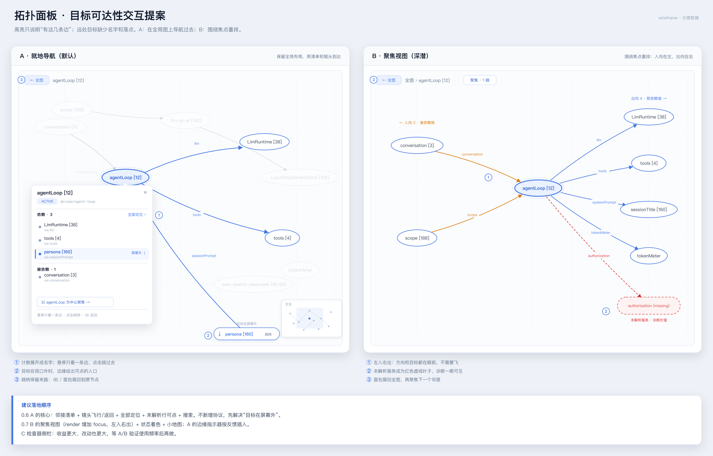
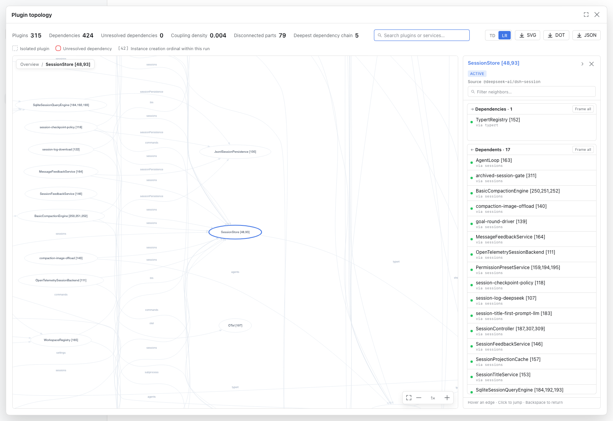

# 拓扑面板：目标可达性交互提案

> 状态：draft，供讨论；不涉及已承诺的 API。
> 现状：`0.5.0` 的节点 popover + `deg⁺`/`deg⁻` 方向高亮。
> 实施状态（未发布）：0.6 采用**右侧常驻 inspector**（可折叠，双 section 独立滚动，顶部局部过滤），浮层 popover 已移除；A2–A5 与未解析行跳转均已实现。A4 为简化版（≤3 个、无折叠/动画）。





> 早期提案里的 popover 形态已被右侧 inspector 取代；上图是 0.6 的实际形态。

## 0. 0.6 已对齐

- 清单放 **右侧常驻 inspector**（360px，可折叠到 40px），画布 flex 占剩余；浮层 popover 已移除。
- 点行 = **目标成为选中并飞过去**；返回栈 + 画布左上角面包屑 + `←`，`Backspace` / `⌘[` 同效。
- 全部定位允许缩到 **0.2–0.25**；再点一次回到原视图。
- 离屏 chip 进 0.6，**简化版**：最多 3 个，只标 `→ name`，不做折叠/动画；完整版留到 0.7。
- 搜索进 0.6：插件名 + 服务名；未解析行可点、选中/历史持久化默认带上。

### 不再逐条确认的默认

- 悬停清单行只强调一条边，移开后恢复整组高亮。
- rail 顶部过滤同时作用于两个方向；过滤不改变图高亮；切换选中时清空。
- 两个 section 按行数比例分配高度；空/全过滤的 section 收缩；列表各自滚动。
- 点击行时目标**已完全在视口内** → 只选中、不移动镜头；否则飞到中心，`k` 夹在 1–2.5。
- 方向 section 头再点一次 = 清高亮；两个 section 的列表常显，不收起。
- 历史每次选中变化入栈（点空白清空除外），上限 20。
- 清单按状态严重度排序，其次名称。
- 搜索：`/` 聚焦，`↑↓` / `Enter`；服务结果高亮所有经过该服务的边。

## 1. 问题不是“线太长”

选中节点、打开 `deg⁺`/`deg⁻` 后，面板只做了两件事：给边染色、给远端节点加环。
当远端在视口外时，用户拿到的是“几条指向屏幕外的线”，缺的是三样东西：

1. **身份**——远端是谁？状态如何？经由哪个服务？
2. **落点**——屏幕外没有可点的目标，线本身又细、又交叉、还出屏。
3. **回程**——真的跳过去了，原来的选中、方向和视口怎么回来？

所以“点线直接跳过去”只解决了第 2 项的一半：它是个不错的**补充入口**，但不可发现、命中率也低（曲线只有 1.4px 宽）。主线应该先是**把远端变成有名字、可点击的对象**，其次才是镜头。

## 2. 两条路线

### A. 就地导航（默认，推荐先做）

不改变全局布局，在现有画布上完成“看见 → 定位 → 到达 → 回来”。

#### A1 邻接清单：右侧 inspector

- 右侧固定 360px inspector（可折叠到 40px）；两个 section 常显，各自的列表独立滚动；点 section 头切换该方向的高亮，再点清除。方向统一用 `→/←`，`deg⁺/deg⁻` 只留在 tooltip/文档里，不再作为可见标签；被合并的边数用 `N edges` 纯文字提示。
  - 每行：`状态点 · 名称 [序号] · via 服务`；屏外目标由画布边缘的 chip 提示（见 A4）。
  - 同一对节点经由多个服务时按 target 合并：`via a · b`。
  - 排序：状态严重度（FAILED → PENDING → 其它）优先，其次名称。
  - 两个 section 按行数比例分配高度；空/全过滤的 section 收缩，最小保留 header + 一行；header 固定，列表各自滚动。
- 顶部过滤框同时过滤两个方向（名称/服务），计数显示 `matching / total`；过滤不改变图高亮；切换选中时清空。
- 悬停行：只保留这一条边 + 目标环，其余已高亮元素降级而不是全灭；目标若在屏外，对应边缘 chip 脉冲。
- 点击行：目标成为选中节点并飞过去；源节点进历史。
- `↑`/`↓` 在行间移动，`Enter` 跳转；悬停与键盘共用同一个 focus ring。
- 数据来源优先用**已经画出来的 SVG**（`g.node` 的 `title`/label、`g.edge` 的 `title` 与 label），这样清单和画面永远一致；状态从 `analysis` 里补（现有的 `resolveNode` 可以抽出来复用）。
- 合并节点（`m:N`）继续显示 `name [1,9,23]`；同名实例仍是一行。

这一步同时解决了一个隐性问题：**图本身不可键盘访问**，清单让“选中—浏览—跳转”第一次有了可访问的替代路径。

#### A2 镜头飞行 + 返回栈

- `flyTo(node)`：300–450ms ease-out，目标居中；缩放保持当前值，低于 1 时抬到 1，高于 2.5 时收到 2.5（避免“飞过去只看到一个大椭圆”）。
- 目标已经完整在视口内时**不动镜头**，只切换选中，避免无谓的跳动。
- 滚轮 / pointerdown / 方向键立即打断动画，不做“锁死镜头”。
- 历史栈保存 `{ selectedKey, direction, transform }`，**每次选中变化都入栈**（点空白清空除外），上限 20。
- 返回：`Backspace` / `⌘[` / 面包屑；恢复选中 + 方向 + 视口，而不是只回到“全图”。
- 选中态和历史持久化进 viewer store：关掉面板再打开还在（现在只持久化了 transform）。
- 可选：飞行中把 source→target 的边临时加粗并保留一条淡出的引导线，落地后脉冲目标环一次。

#### A3 全部定位

- section 头部的 `Frame all` 按钮：把“选中 + 当前方向全部目标 + 边 label”的 bbox 框进视口。
- 和全图 fit 不同，这里允许缩小到 `k < 1`（`fitView` 现在的 `MIN_FIT_K = 1.0` 只适合全图）；下限 0.2–0.25，并在角落提示当前比例。
- 再点一次回到飞行前的 transform；`Esc` 也回。
- 如果目标组太散、缩到 0.25 仍装不下，保持居中并让 A4 的离屏 chip 接管。

#### A4 离屏指示器（0.6 简化版）

- 只在方向高亮时出现。0.6 只做**最多 3 个**：取选中节点与目标在屏幕上的中心，连线与视口内缩 12px 的矩形求交，得到 chip 位置；文案 `→ name`（出）/ `← name`（入），点击 = 飞过去。
- 不做同角排序、折叠 `+N`、回程脉冲和动画；超出的目标靠清单 + A3 全部定位覆盖。
- 几何缓存：SVG 挂载后一次性算出每个节点的 bbox/center（graph 坐标），之后每帧只做仿射变换，不重复 `querySelector`。
- 完整版（全部屏外目标 + 折叠 + 回程 chip + 脉冲）留到 0.7。

#### A5 搜索

- 工具栏搜索框，`/` 聚焦；匹配插件名、实例序号、服务名。
- 插件结果 → 选中 + 飞行；服务结果 → 高亮所有经过该服务的边，并列出相关插件（“谁在用 llm？”这种反向查询）。
- 结果行带状态点、度数；`↑`/`↓` + `Enter`。
- 189 个节点时，这比在图上找快一个数量级；也是 B 的天然入口（`Enter` 选中，`⌘Enter` 直接聚焦）。

### B. 聚焦视图（深潜模式）

当用户是“逐个插件深挖”而不是“扫一眼全局”时，最根本的解法不是飞，而是**重排**：以当前节点为中心，左入右出。

- 入口：卡片里的「聚焦」/ 双击节点 / 搜索结果 `⌘Enter`。
- 后端给 `render` 增加可选 `focus` 参数：

  ```ts
  render(format, rankdir, theme, focus?)
  ```

  - `focus` 用 **label（同名组）或成员 id 列表**，不要用 `m:N`——那是显示层临时 id，每次投影都可能变。客户端从 SVG label 剥掉 `[..]` 得到基名即可；host 端复用 `mergeByName` 解析。
  - DOT 用 `rankdir=LR`：`in -> focus` 自然落在左列，`focus -> out` 落在右列；焦点居中。
  - 出向边蓝色、入向边琥珀色（或实线/虚线区分）；边 label 保留服务名。
  - 未解析服务以**红色虚线叶子**挂在焦点右侧（`focus -> "s:missing"`），这是诊断价值最高的一笔。
  - 默认 1 跳；2 跳可选，但要防止爆量。
  - 结果缓存键 `focus + rankdir + theme`，重新加载拓扑时失效。
- 交互：点邻居 = 以它为新的焦点（push 历史）；面包屑 `全图 › agentLoop › LimRuntime` 回退；`Esc` 退到全图。
- 取舍：
  - 失去全局坐标感；布局要重算（百毫秒级，视图大小）；需要 loading 过渡。
  - 适合“这个插件到底依赖谁 / 谁依赖它”；不适合巡检整体健康度。
- 与 A 的关系：A 是默认交互，B 是一个可进入/退出的模式；两者共享面包屑、选中态和历史。

### C. 检查器侧栏（已提前到 0.6）

画布 + 右侧 360px 常驻 inspector：节点详情、两个方向的关系列表、局部过滤、Frame all、折叠/展开。
0.6 已采用：列表不再遮挡画布，高 degree 时两个 section 各自滚动；代价是图区固定变窄 360px，可折叠。
0.7 可继续做拖拽宽度、窄屏下的 bottom sheet，以及 inspector 里的 Focus（B）/服务查询摘要。

## 3. 其他整体改进（按性价比）

1. **未解析表行可点击** → 定位到对应插件节点。现在这张表是死的，但它是面板里信息密度最高的一块。
2. **指标可交互**：点“未解析 1”展开表；点“不相连 52”高亮孤立簇；后续可加 `FAILED`/`PENDING` 计数与筛选。
3. **状态着色**（`NEXT-STEPS.md` 已有）：`FAILED` 红、`PENDING` 琥珀、`DISPOSED` 灰虚线；合并节点取最差状态。
4. **边作为一等对象**：悬停边浮出 `A → B · via service`，并联动清单行；双击边 = 去目标；单击边可选中边（可选）。这是给“我就想顺着这条线走”的用户留的入口。
5. **方向流动画**：高亮时沿边做一次 1s 的 dash 流动，出向向外、入向向内；方向语义不用靠猜。
6. **小地图**：缩略图 + 视口矩形 + lit 目标点；拖动平移、点击跳转。用同一份 SVG 字符串缩放着色即可，不必重新布局。
7. **键盘体系**：`/` 搜索、`F` fit、`0` 100%、`↑↓` 选邻、`Enter` 跳、`⌫` 返回、`Esc` 清除；在面板里放一个 `?` 帮助浮层。
8. **持久化**：选中/方向/历史；面板最大化状态；当前 rankdir（现在切主题会重新拉，但 rankdir 不持久）。
9. **视觉微调**：高亮时 dim 从 `0.12` 提到 `0.18–0.22`，保留上下文；目标环略强；高亮边 label 加底色。
10. **性能**：预计算节点 bbox/边端点；`applyHighlight` 目前每次全量扫 `g.edge`，在 193 条边没问题，但为 1000+ 条边留好缓存结构。

## 4. 实现要点（供估工）

- **A1/A2/A3/A4/A5 全部是 client-only**，不改 `render` 协议。节点几何用挂载后的一次性 `getBoundingClientRect`/`getBBox` 缓存，之后飞行与 chip 只做仿射变换。
- **A2 的镜头 API 要上提**：`view` 现在在 `TopologyGraphView` 内部，popover 在它外面，无法直接驱动镜头。建议把 `view` 提到 `TopologyView`（或暴露命令式 `flyTo`），顺带统一 store 与动画；否则只能把跳转意图写进 store 再由 graph view 消费，链路更绕。
- **A1 的数据**从 SVG 取（`g.node` 的 `title`/文本、`g.edge` 的 `title` + label），状态从 `analysis` 补；现有 `edgeStats`/`resolveNode` 可以抽出复用。这样清单与画面不会脱节。
- **B 要改三处**：`render` 方法签名（`focus?: string`）、`typert.ts` 的 parameters、`remote-client.ts` 的类型；host 端在 `renderDot` 前按 focus 过滤子图，复用 `mergeByName`。`focus` 用 label 基名或成员 id 列表，**不要用 `m:N`**。
- **B 的 fit** 不能复用现在的 `fitView`：它的 `MIN_FIT_K = 1.0` 会把高的焦点图裁掉；聚焦视图需要允许 `k < 1`。
- **客户端状态**建议收敛为：`selection`、`direction`、`history[]`、`hover`、`focus`；`selection/history` 放进现有 viewer store，面板重开后可恢复。

## 5. 建议落地顺序

| 版本 | 内容 | 说明 |
| --- | --- | --- |
| `0.6.0` | A1 右侧 inspector（独立滚动 + 过滤 + 折叠）+ A2 飞行/返回 + A3 全部定位 + A4 简化 chip + A5 搜索 + 未解析行可点 | 不动远程协议；直接解决“目标在屏幕外”和高 degree 遮挡 |
| `0.7.0` | Service inspector + missing services + startup timeline（live topology doctor；见 [`0.7-service-inspector.md`](0.7-service-inspector.md)） | 只诊断已加载的 DSH；不做 boot rescue |
| `0.7.x` | B 聚焦视图 + A4 完整版 + 状态着色 + 小地图 + impact/SPOF/layers | 需要 host/client 同步改；先做 1 跳 |

验收口径：

- 从任意节点出发，**≤2 次点击**到达任一直接邻居（清单或边缘 chip）。
- 跳转后**1 次操作**回到原选中 + 原方向 + 原视口。
- 任意方向高亮时，屏幕外目标在视口边缘都有可见、可点的入口。
- 清单、画布、搜索三处的“当前选中”始终一致；SVG 重绘（主题/rankdir 切换）后仍然一致。

## 6. 现在明确不做

- 换掉 Graphviz 做前端力导向/增量布局：会丢掉分层语义，189 节点的标签碰撞、性能、导出格式都要重做；B 已经能用 `dot` 拿到“局部重排”的收益。
- 全局 fisheye/放大镜：对“目标在屏幕外”帮助有限，反而增加理解成本。
- 多选 / 双节点对比：等单点导航稳定后再看。

## 7. 待定问题

- ~~邻接清单放 popover 还是 rail？~~ 已定 0.6 右侧常驻 inspector（可折叠）；popover 已移除。
- ~~点击行是选中还是预览？~~ 已定“选中 + 返回栈”；`Alt+点击` 的 peek 作为后续增强。
- B 的 `focus` 是否同时开放给 `graph.render` 工具（让模型也能要“X 的邻域图”）？倾向开放，但需要单独设计参数语义。
- 状态颜色和方向颜色如果同时上，节点描边会打架；建议**节点用状态、边用方向**，选中态用外环而不是改描边。
