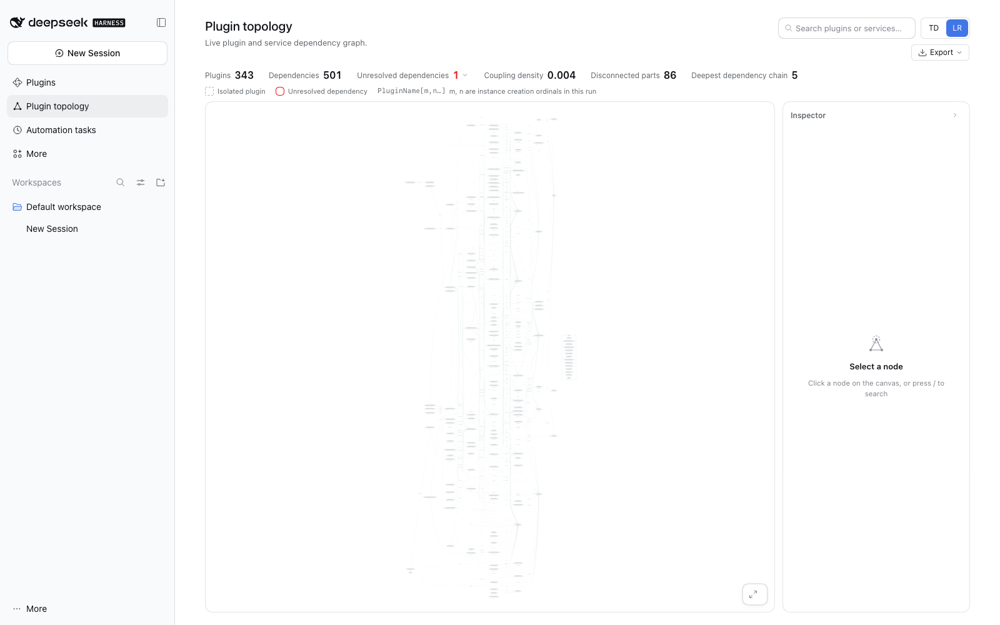
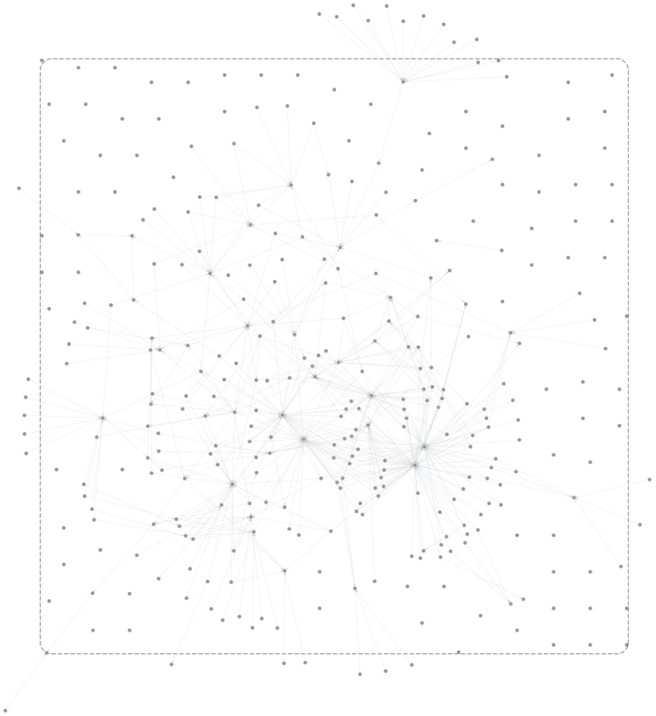
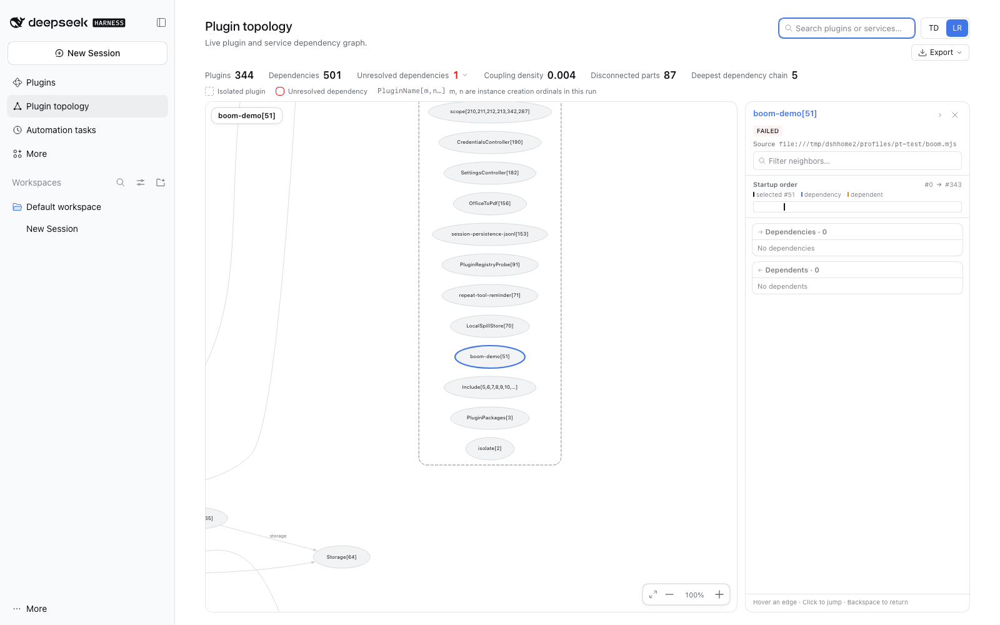

# 观测台手记：从“画出来”到“看见”（2026-11）

> 状态：讨论记录，不是已承诺的 API，也不是路线图。
> 读法：下次想选方向时，直接从第 6 节“还在烧的碳火”里挑一块，不必从头推演。
> English summary: A discussion note on repositioning the plugin from "an under-qualified
> debugger" to a live observatory of the Cordis/DSH assembly. It records the 2026-11 live
> experiments, three positioning corrections, what was deliberately dropped (diff,
> metrics-as-verdicts, a findings dashboard as the main line), and four candidate visual
> directions: macro constellation, growth replay, living map, cinematic mode.

## 0. 一句话

这个插件不负责救火；它负责让 Cordis 装配体的结构与演化变得可感知。用这次讨论里的定义：**好看 = beautiful + eye easy**——不是视觉舒适，而是让本来不可见的设计与运行结构，以一种容易“看见”的方式呈现出来。

“有用”在这个定位下不是“帮我修好一个 ticket”，而是“看完之后，我脑子里的模型变了”。

## 1. 这次讨论是怎么被点着的

起因是“下一版做什么”的路线评估。第一轮从 `NEXT-STEPS.md` 和 `0.7` 设计文档出发，得出“补诊断”的结论；随后被要求别只看文档，真起一个实例看看。实测之后，结论被推翻了两次。

实测环境：

- 插件 `0.9.1`，DSH `0.2.2-rc.1`，cordis `4.1.0`，`pt-test` profile。
- 343 个插件、501 条依赖、1 条 unresolved、86 个孤立部分、最大依赖深度 5。
- 无头 Chromium，1600×1000；页面实际画出的主图 148 个节点、孤立组 14 个。
- 另用 profile patch 的 `insert` 注入了一个 `apply()` 必抛错的插件，观察“坏掉时页面告诉我什么”。

## 2. 实测看到的四件事

### 2.1 全局图在真实规模下“不可读”，但不该被拆掉

页面初始以 100% 打开，落在图的任意中段；整张 SVG 的 viewBox 是 **2729×7609**，点 `Fit to view` 变成 **10%**，整张图缩成一条几乎看不见的细线：

我一开始的结论是“要聚合/下钻”，这个结论是错的：鸟瞰图有它自己的信息——像星空的宏观结构、鱼群的宏观结构。问题不在“宏观”，在构图和绘制。

同一份导出 DOT，只换布局引擎：

| 引擎 | 尺寸 | 宽高比 |
| --- | --- | --- |
| `dot`（当前） | 2110×18328 | 0.12（针） |
| `unflatten` + `dot` | 2092×14579 | 0.14（仍是针） |
| `neato` | 1405×1328 | 1.06 |
| `fdp` | 20215×18814 | 1.07 |
| `sfdp` | 1032×988 | 1.04 |
| `twopi` | 1310×1232 | 1.06 |
| `circo` | 19042×20582 | 0.93 |

尺寸随本次运行变化，下面是比例关系，不是绝对值。

再把标签去掉、节点缩成点、边变细，就是一张真正的星图：

数据没变，只换了布局和画法。中心是稠密的依赖核，外面一圈稀疏尘埃，几个 hub 带星芒。`dot` 是层级布局，优化 rank 间距；`neato`/`sfdp` 是力导向，优化的是“场”的平衡——所以物理感不是错觉。

需要说明：这是预处理过的 DOT 预览（去标签、点形状、细边），不是线上渲染；`neato` 在 343 节点上是秒级，1000+ 需要再测。

一个附带发现：外围的“尘埃”大多是 `Include` / `Group` / `scope` 这类零度结构节点。它们不是服务依赖，却占了大量版面。宏观模式里把它们做成暗尘埃或默认隐藏，构图会立刻干净很多。

### 2.2 真正承载信息的是 search + 右侧 rail

- 搜服务 `tools`：1 个 provider、65 个 consumer、bus factor 1，直接标 `critical`；启动顺序条和 provider/consumer 列表都在一屏内。
- 搜插件 `ToolsService`：1 条 dependency、29 条 dependents、源码包、创建序号。

这不是“漂亮”，这是这个工具目前最扎实的部分。宏观图给的是形状，rail 给的是事实。

### 2.3 FAILED 是隐形的

注入的 `boom-demo` 在启动时抛错。启动日志明确打出 “1 entry did not activate” 和完整堆栈；页面这边：

- 插件数 +1、孤立节点 +1；
- **全页 0 次 FAILED 提示**；
- 节点和普通节点长得一样；
- 只有搜到它、点开，才看到 `FAILED` 徽章和源码路径，**没有任何错误信息**。

错误实际就在 host 的 `fiber._error` 里，只是没被取出来。

### 2.4 PENDING 只到“缺什么”，不到“怎么办”

那个 PENDING 的 `scope` 缺 `pluginMarket`：rail 能列出 missing services，但不会告诉你这个服务该由谁提供、该装什么。`src/service-model.ts` 里的 `diagnose()` 已经写好了 message / evidence / suggestion，也有测试，但没有接到页面和模型工具上。`graph_render` 返回的是 165KB 的整图 JSON，没有一份“体检结论”。

## 3. 三次定位修正

1. **第一版：补诊断。** 看到 FAILED 隐形，就想加错误信息、findings、`topology_diagnose` 工具。被“只在此山中”推翻：我们本身是装配里的一个体量不轻的插件；整个 UI 起不来时我们不在场，L0 排错有专门的工具和人在做。把自己放到排错位置上，既救不了场，又把自己的失败风险变成产品风险。
2. **第二版：可读性 = 聚合/下钻。** 被“星空/鱼群”推翻：宏观视角有独立价值，聚合会把它变成一张表。该优化的是构图、LOD、绘制，不是把图拆掉。
3. **第三版：观测台。** 一个感知工具，不是 debugger。它让结构变得可感，让变化可以游历；至于“看完能干什么”，答案是“你看见了一些本来看不见的东西”，而不是“你修好了什么”。

## 4. 边界

- **L0 整个 UI 起不来**：不在场，不做。日志、launcher、专用 doctor 的领域。
- **L1 起来了、某个插件 FAILED/PENDING**：在场，能看到；但这是观察，不是救火，也不该由我们负责修。
- **L2 结构理解**：这是我们的位置。

关于 DevTools 类比：关键不是功能，是**观察者与被观察者分离**。DevTools 能 attach/detach、能在页面脚本之前介入、能在崩溃前留下现场；我们现在是页面里的一个组件，和页面同生共死。真要往那个方向走，形态会变：轻量 host agent（只出快照/事件）+ 外部 viewer（可多实例、可重连）+ launcher 级 hook 才能看 L0。那是另一个产品，不该塞进这个插件。

非目标：L0 救援、事故排错、插件管理、这个规模下的 diff、把图论指标当价值判断。

## 5. 放弃/暂缓的想法（免得下次重新捡起来）

- **diff**：动态布局没有稳定的空间锚点；表格化又和“游历”打架。它更像代码 diff 的直觉，在这里不成立。
- **图论指标作为好坏判断**：强弱耦合不是价值判断，Unix 进程单根 fork 就是反例。指标可以退成视觉编码（度数→点的大小/亮度，状态→颜色，深度→半径），不做评分。
- **大而全的 findings 面板作为主线**：错误信息可以顺手显示，但它不构成产品定位。
- **聚合/下钻作为默认宏观视图**：会丢掉星空。

## 6. 还在烧的碳火

### A. 星图模式（macro constellation）

- **想法**：有机布局（`neato`/`sfdp`）+ LOD。宏观隐藏标签，节点缩成点/光晕，边变细，零度结构节点做尘埃；缩放后回到带标签、可点选、可打开 rail 的详细图。
- **已有证据**：上面的布局对比和星图预览；同一份数据，零协议改动。
- **下一步**：一个可丢弃的原型——给 `render` 加 engine 选项，先看真实交互下缩放、点选、rail 是否还成立；再测 1000+ 节点。
- **风险**：力导向在更大图上变慢；失去 rank 语义；标签/点之间的切换；图和 rail 的联动要重新校准。

### B. 生长回放（growth replay）

- **想法**：时间变成运动。root → 第一批插件 → 服务连线 → 后续分支 → 状态落定；镜头轻移。不是复刻 Gource，是借用“结构自己长出来”的原则。
- **已有证据**：snapshot 里有 creation ordinal，启动时间线模型已经在；差的只是时间轴动画。
- **下一步**：先在固定 `neato` 布局上做一个 10 秒生长动画（节点按 ordinal 出现、边渐显），验证感觉；如果值得，再把交互层换成客户端力导向。
- **风险**：Graphviz 每帧重排不可行；当前状态是快照，回放的是“重构的生长”而不是真实历史；性能。

### C. 活的地图（living map）

- **想法**：订阅 `internal/plugin` / `internal/status` / `internal/service`，让地图随装配变化轻轻生长/闪烁；页面是一个可以待着的“地方”。
- **下一步**：先验证事件捕获（我们加载得晚，会错过启动早期的变化）；等 A/B 有结论后再考虑。
- **风险**：host 变重；噪声；实时数据的范围有限。

### D. 电影/演示模式（cinematic mode）

- **想法**：隐藏 chrome 和 rail，自动取景，慢速平移/缩放，导出一张图或一段动图；用于分享、文档、演讲。
- **下一步**：成本最低的支线，几乎不需要新布局。
- **风险**：容易变成纯装饰；需要和 A/B 一起设计才有意义。

横切的设计杠杆：零度结构节点（尘埃/隐藏）、指标作为视觉编码、布局引擎作为“视角”而不只是参数。

## 7. 待回答的问题

1. 主用户是谁：自己？Cordis/DSH 插件开发者？核心开发者？agent？演示/分享的观众？
2. 先吹亮哪一块：A 星图，还是 B 生长回放？（我倾向先 A：成本最低，能立刻看到真实交互下的样子。）
3. 接受“感知标准”作为验收吗？怎么验收：截图、观感、“能否用一句话描述这个装配的形状”、用户 smoke？
4. 愿不愿意为“动”重写布局层（客户端力导向，host 只做数据和导出）？这会同时服务 A 和 B，但会把 Graphviz 从交互主路径上挪开。
5. 零度结构节点默认隐藏，还是做尘埃？

## 8. 品味注记

这次讨论里有一句话值得留在项目里：

> AI 年代写软件感觉都是说着给别人做，找用户，其实最后都表述的是自己的内心，外延的是自己的品味。

这个项目的第一动机不是需求，而是“Cordis 这种机制会有这样一个动态的结构，想把它绘制出来”。所以评估方向时，除了“有没有用”，还可以问一句：**它是不是更接近我想看到的那个东西？** 这也是为什么“只能做好看”不是退而求其次——观测台本来就是一种让人看见的工具。

## 9. 复现实验

- **布局对比**：页面 Export → DOT 得到完整 DOT；用 `@hpcc-js/wasm-graphviz` 的 `layout(dot, 'svg', engine)` 依次跑 `dot` / `neato` / `fdp` / `sfdp` / `twopi` / `circo`，再用 `unflatten()` + `dot` 对照；`rsvg-convert` 缩放成图。
- **星图预览**：把 DOT 的节点默认形状改成 `point`、清空 label、边改成细线，再跑 `neato`。
- **失败插件**：在 profile 的 `cordis.patch.yml` 里用 `insert` 加一个模块，`apply()` 直接 `throw`；启动日志会记 “1 entry did not activate”，页面用于观察它是否可见。
- **环境**：插件 `0.9.1` / DSH `0.2.2-rc.1` / cordis `4.1.0` / macOS / 无头 Chromium。
